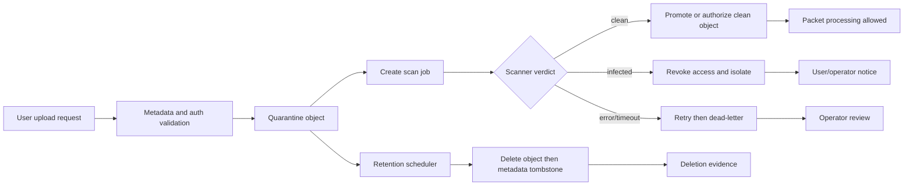

# DSAI Malware Scanning and Deletion Lifecycle Remediation Action Plan

## Release decision

DSAI currently has a useful **quarantine-first foundation**, but it is not yet a complete production malware-scanning and deletion service. `server/fileSecurity.ts` validates a narrow MIME allowlist, file size, SHA-256 format, user quarantine namespace and retention expiry. It deliberately fails closed when `MALWARE_SCANNER_URL` and `MALWARE_SCANNER_API_KEY` are absent. The remaining gaps are a real scanner adapter, scan-job state transitions, signed verdict handling, object deletion, deletion evidence and an operational retry/dead-letter path.

This direction follows the [OWASP File Upload Cheat Sheet](https://cheatsheetseries.owasp.org/cheatsheets/File_Upload_Cheat_Sheet.html), which recommends validation beyond the client-supplied Content-Type, authorization, size limits, segregated storage, antivirus or sandbox scanning and content disarm/reconstruction where applicable.

## Target lifecycle

## Priority action plan

| Priority | Action | Implementation detail | Acceptance evidence |
|---|---|---|---|
| P0 | Keep quarantine fail-closed | Do not return a clean/downloadable asset while `scanStatus` is `quarantined`, `scanning` or `error`; block packet processing | Unit tests prove only `clean` plus unexpired asset can be read |
| P0 | Add scanner adapter contract | Define `scan(bytesOrObjectRef, sha256, mimeType, size)` returning signed provider-independent verdict, provider ID, scan ID, signature, timestamp and message | Contract tests cover clean, infected, timeout, malformed verdict and duplicate callback |
| P0 | Add scan-job persistence | Add `file_scan_jobs` with asset ID, idempotency key, status, attempts, provider scan ID, next retry, last error and timestamps | Duplicate upload/callback cannot create duplicate terminal state |
| P0 | Verify webhook/callback authenticity | Require provider signature, timestamp tolerance, asset nonce or scan ID match, and one-time terminal transition | Forged callback is rejected and logged without changing asset state |
| P0 | Isolate infected files | Mark `infected`, revoke all access, preserve minimal forensic metadata, notify user/operator without exposing payload | Infected asset is never returned by clean lookup or packet bundle |
| P0 | Implement real object deletion | Use a provider-supported delete operation or a controlled storage lifecycle rule; never treat DB-row deletion as sufficient proof of object deletion | Deletion job records provider result, attempt count and evidence ID |
| P0 | Replace destructive cleanup with tombstones | On expiry, mark `expired`, delete/quarantine object, then retain minimal non-content tombstone for audit; avoid broad `DELETE` without scoped IDs | Re-running cleanup is idempotent and does not erase audit evidence |
| P1 | Add retention policy configuration | Separate quarantine retention, clean-file retention and infected-file retention; cap operator values and display the active policy | Policy is visible in `files.policy` and documented for users/operators |
| P1 | Add content inspection | Validate magic bytes, reject polyglot/mismatched content, optionally run CDR for PDF/DOCX and image normalization before downstream use | Test corpus includes mismatched extension, oversized file, malformed PDF and EICAR in a non-production test environment |
| P1 | Add retry/dead-letter operations | Exponential backoff with bounded attempts; dead-letter queue/status visible to admin; manual retry requires admin role | Simulated provider outage yields bounded retries and operator-visible dead letter |
| P1 | Add audit events | Record upload accepted, scan started, verdict, access denied, deletion requested, deletion completed and failure without storing file contents | Audit event has actor/system, asset ID, action, reason and timestamp |
| P2 | Add malware-response playbook | Define containment, notification, credential rotation, provider escalation, evidence preservation and incident closure | Operator can execute a documented tabletop drill |
| P2 | Add backup/restore deletion controls | Ensure expired/deleted object is excluded from active restore and define backup expiry/legal hold behavior | Restore drill proves deletion request handling is not silently undone |

## Suggested schema evolution

Extend `file_assets` with `quarantineExpiresAt`, `cleanExpiresAt`, `infectedAt`, `deletionRequestedAt`, `deletionCompletedAt`, `deletionProvider`, `deletionMessage` and a stable `contentVersion`. Add `file_scan_jobs` for retries and provider correlation. Add `file_asset_audit_events` for append-only security events. Avoid storing file bytes, scanner payloads or sensitive document text in these tables.

The current `cleanupExpiredFileAssets()` reports `storageDeleteSupported: false` and deletes metadata by expiry condition. The production replacement must first identify a bounded set of asset IDs, attempt object deletion, write a result, and only then update the metadata state. A failure must preserve the row as a retryable tombstone rather than making the object appear deleted.

## Operator gates and launch criteria

Do not enable uploads until a signed scanner adapter, object deletion mechanism, retry path and incident owner are configured. Do not claim deletion completion from a database-row deletion alone. The launch gate is a successful clean-file test, infected-file test, forged-callback test, timeout/retry test, retention deletion test, ownership test, backup/restore review and mobile low-network test.

## 30/60/90-day sequence

During days 0–30, freeze the existing fail-closed behavior, add schema and adapter contracts, select a scanner provider, define the data map and build contract tests. During days 31–60, ship the scan worker/callback, object deletion and tombstone lifecycle in a staging environment; run EICAR and malformed-file tests only in the isolated test environment. During days 61–90, run a controlled alpha, complete incident and restore drills, measure scan latency/error rate and only then enable production uploads for approved MIME classes.
