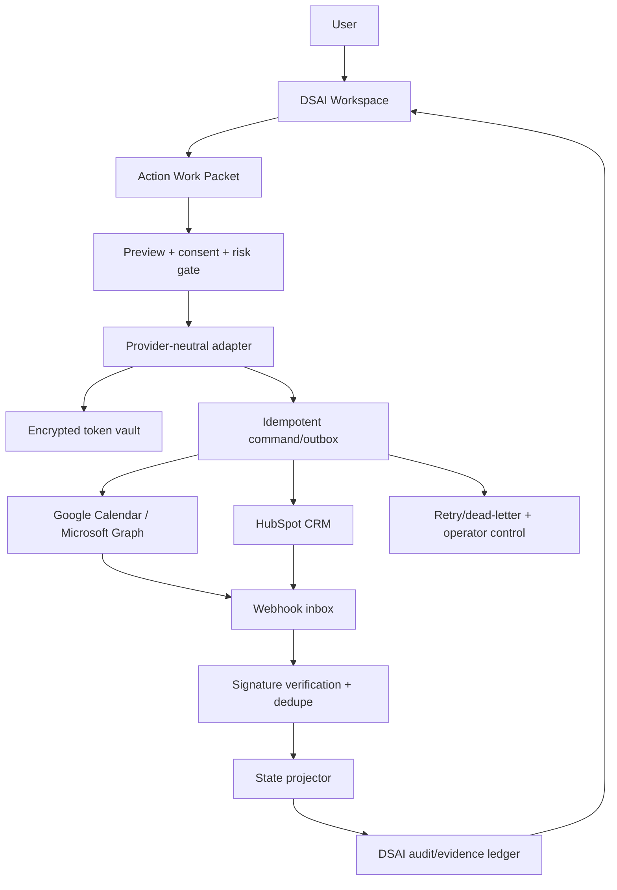

# DSAI Provider-Gated CRM and Calendar Integration Proposal

## Design objective

Add CRM, calendar and messaging capabilities without turning DSAI into an unsafe autonomous side-effect engine. The first release should be **preview-first**: DSAI prepares a proposed contact update, follow-up or calendar slot; the user reviews the exact payload; only then does a connected provider adapter execute it with an idempotency key and an audit event.

The architecture should preserve the current Work Packet model. Every proposed external action becomes a Work Packet or an action packet with source, evidence, consent, target, risk, preview, approval and provider result fields.

## Provider strategy

| Capability | First provider candidate | Alternative | Initial scope posture |
|---|---|---|---|
| Calendar availability and events | Google Calendar | Microsoft Graph Outlook Calendar | Start with free/busy or owned-event scopes; request write only for confirmed event creation |
| CRM contacts/deals/tickets | HubSpot | Salesforce or a future neutral CRM adapter | Start with read-only contact/deal discovery; write only after explicit action approval |
| Messaging | Provider-specific adapter selected after consent and jurisdiction review | Email/SMS/WhatsApp provider | No live send in the first integration milestone; dry-run only |

The [Google Calendar scope documentation](https://developers.google.com/workspace/calendar/api/auth) distinguishes free/busy, read-only and event write scopes; DSAI should request the narrowest scope for the chosen workflow. Google also notes that public applications using certain user-data scopes may require provider verification. The [HubSpot webhook guide](https://developers.hubspot.com/docs/api-reference/latest/webhooks/guide) requires a secure HTTPS endpoint, app-level subscription configuration, OAuth installation and object-specific scopes. It also documents lifecycle events such as creation, property change, deletion, restore and privacy deletion.

## Architecture



## Core adapter contract

```ts
interface ProviderAdapter {
  provider: "google_calendar" | "microsoft_calendar" | "hubspot_crm";
  connect(input: { userId: number; redirectUri: string }): Promise<{ connectionId: string }>;
  getCapabilities(connectionId: string): Promise<string[]>;
  preview(command: ExternalCommand): Promise<ExternalPreview>;
  execute(command: ExternalCommand, approval: Approval): Promise<ExternalResult>;
  handleWebhook(request: SignedWebhook): Promise<WebhookOutcome>;
  revoke(connectionId: string): Promise<void>;
}
```

`preview()` must not create, edit, message or book anything. `execute()` must require a current user approval token, a stable idempotency key, a provider connection in `ready` state and a bounded command payload. A provider response must be stored as a minimal result, not as an unrestricted copy of the provider record.

## Data model proposal

Add `provider_connections` with user ID, provider, encrypted refresh-token reference, scopes granted, status, last health check, revoked-at and created/updated timestamps. Add `external_action_commands` with packet ID, connection ID, action type, sanitized payload hash, idempotency key, approval event ID, status, provider object ID, retry count and timestamps. Add `provider_webhook_events` with provider, event ID, signature result, payload hash, dedupe status and received/processed timestamps. Keep access tokens outside ordinary query results and never expose them to the browser.

## Calendar flow

The user selects “check availability” or “prepare event.” DSAI requests only free/busy or owned-event permission for the selected calendar workflow, shows the timezone and exact interval, and creates a preview packet. For event creation, the preview must include title, attendees, start/end, timezone, location, description and notification behavior. The user explicitly approves. The command is written to an outbox with an idempotency key; the adapter executes once, records the provider event ID and projects the result back to the Work Packet. Webhook or change-notification support is added only after callback HTTPS, verification, renewal and retry handling exist.

## CRM flow

The user selects a bounded object type such as contact or deal. DSAI first reads only the fields required to resolve a target and displays the matched record without silently modifying it. A proposed update or follow-up is represented as a preview with field-level diff, source/evidence, risk and recipient/target identity. The user approves the exact diff. The adapter writes with an idempotency key and stores only the provider ID, result status and sanitized field hash. HubSpot webhook events are verified, deduplicated and mapped to the local state projector; privacy deletion events trigger the appropriate DSAI deletion workflow.

## Security and reliability controls

Use OAuth authorization code flow with state/PKCE where supported, narrow scopes, encrypted server-side token storage, token rotation, callback allowlists and revocation. Verify webhook signatures and timestamps, reject replayed event IDs, use exponential backoff and a dead-letter state, and expose an admin disable switch per provider. Apply per-user and per-provider rate limits. Never allow an LLM to choose recipients, attendees, scopes or irreversible actions without a deterministic validation layer and human approval.

## Rollout gates

The integration remains disabled until provider credentials, consent text, privacy/data map, callback HTTPS, scope review, webhook verification, token revocation, idempotency, retry/dead-letter handling, audit events, test tenant and rollback procedure are complete. The first milestone is read-only discovery and dry-run previews. The second milestone is user-approved single-object writes. Bulk writes, automatic follow-up messages, autonomous booking and recurring campaigns require separate review and must not be enabled by default.

## References

1. [Google Calendar API scopes](https://developers.google.com/workspace/calendar/api/auth)
2. [HubSpot Webhooks API guide](https://developers.hubspot.com/docs/api-reference/latest/webhooks/guide)
3. [Microsoft Graph subscription resource](https://learn.microsoft.com/en-us/graph/api/subscription-post-subscriptions?view=graph-rest-1.0)
